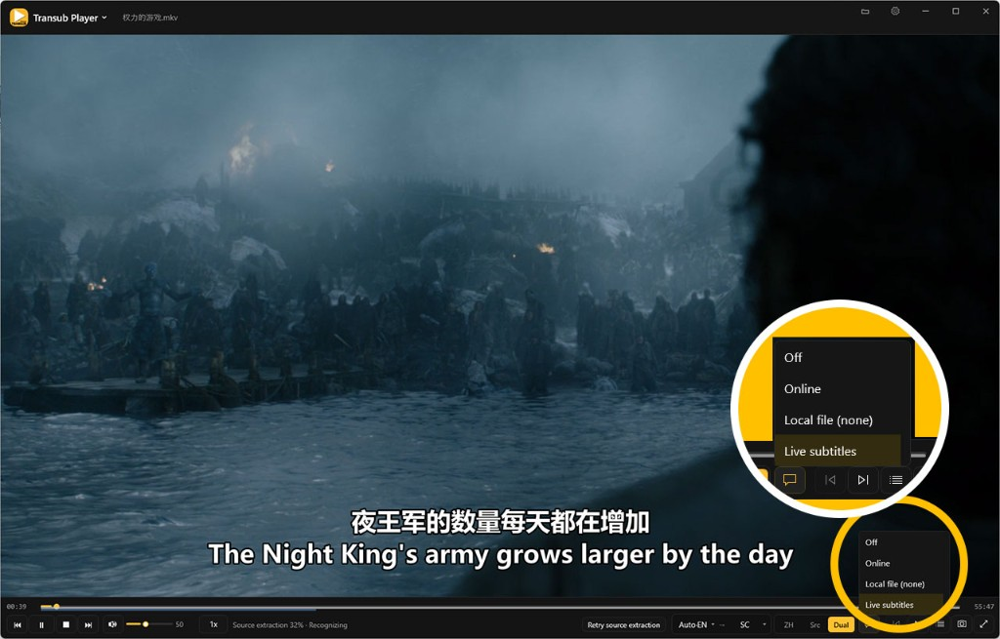

# Transub Player

<p>
  <a href="https://github.com/dlsandy/Transub-Player/releases"></a>
  <a href="https://github.com/dlsandy/Transub-Player/releases"></a>
  <a href="https://github.com/dlsandy/Transub-Player/stargazers"></a>
  <a href="https://github.com/dlsandy/Transub-Player/issues"></a>
  <a href="https://github.com/dlsandy/Transub-Player"></a>
  <a href="https://dotnet.microsoft.com/"></a>
</p>

<p>
  
  
  
  
  
  
</p>

[English](README.md) | [简体中文](README.zh-CN.md) | [日本語](README.ja.md) | [한국어](README.ko.md)

**영상을 열면, 자막이 따라옵니다.**

외국 영화, 드라마, 애니——자막 파일이 없어도 먼저 볼 수 있습니다.  
열면 화면이 바로 나오고, 읽기 쉬운 자막이 곧 따라붙습니다. 자막 사이트를 헤매지 않아도 시청을 이어갈 수 있습니다.

<p align="center">
  
</p>

> Windows 데스크톱 플레이어 · 현재 버전 1.8.0  
> [GitHub](https://github.com/dlsandy/Transub-Player/releases) 또는 [GitCode](https://gitcode.com/AndyDai/Transub-Player/releases)에서 설치 프로그램이나 포터블 패키지를 받으세요. 앱 안의「업데이트 확인」으로도 업그레이드할 수 있습니다.

---

## 왜 Transub Player인가

**보면서 자막이 생성됩니다**  
내장 음성 인식으로 자막을 실시간 생성합니다. 진행 상태가 보이므로, 멈춘 건지 돌아가는 건지 헷갈리지 않습니다.

**번역 · 원문 · 이중 언어, 한 번에 전환**  
편하게 볼 때는 번역, 학습할 때는 이중 언어. 번역이 아직 준비되지 않아도 원문 자막으로 재생은 이어지고, 시청은 끊기지 않습니다.

**중 / 일 / 한 / 영 / 스 상호 번역**  
재생 중 소스 언어와 번역 언어를 바꿀 수 있고, 스페인어 UI도 지원합니다. 파일 이름으로 소스 언어를 추정하기도 합니다. 기본은 「빨리 이해하기」이며, 필요할 때 강화할 수 있습니다.  
앞으로 더 많은 언어를 지원할 예정입니다.

**스트리밍 재생과 녹화**  
일반적인 네트워크 스트림 URL을 바로 재생합니다. 나중에 다시 보고 싶다면 한 번에 로컬로 녹화할 수 있습니다.

**휴대폰 스캔 재생**  
컨트롤 바 Wi‑Fi 진입과 공유 폴더. 휴대폰 브라우저에서 영상을 고르면, 실시간 자막은 PC Whisper/번역이 만듭니다. 웹에서 번역/원문/이중/끄기를 전환할 수 있고, 트레이로 최소화해도 LAN과 인식은 계속됩니다.

**컬러 그레이딩 & LUT**  
우클릭「조색」: 밝기/대비/채도 등을 실시간 조정하고 이름 있는 프리셋으로 저장. 내장 3D LUT, 사용자 `.cube`/`.3dl`, 영상과 같은 이름의 옆 폴더 LUT 자동 적용을 지원합니다.

**화질 향상**  
우클릭「화질 향상」, 또는 `E`로 끄기 / 가볍게 / 향상 순환(샤픈, 디밴드, 고품질 스케일). 기본은 끄기. 끊기면 끄기나 가볍게로 되돌리세요.

**시크 썸네일**  
진행 바에 마우스를 올리면 해당 시점 화면을 미리 볼 수 있어 위치를 잡기 쉽습니다.

**Transub 자막 생성기와 깊이 연동**  
Transub로 고품질 자막을 만들면, 준비된 뒤 플레이어가 재생을 안내합니다.

---

## 이런 분께

- 외국어 콘텐츠를 당장 이해하고 싶지만, 자막 사이트를 헤매고 싶지 않은 분  
- 자막이 없고, 「한 편 보려고」 무거운 작업을 하고 싶지 않은 분  
- 「배포용 완성 자막인가」보다 「계속 볼 수 있는가」가 더 중요한 분  

배포 가능한 중국어 자막, 본격 정제·품질 검사가 필요하면 연계 제품 [Transub](https://www.transub.cc)를 사용하세요.

---

## 다운로드와 시작

1. [GitHub Releases](https://github.com/dlsandy/Transub-Player/releases) 또는 [GitCode Releases](https://gitcode.com/AndyDai/Transub-Player/releases)에서 받기 (앱 안 「업데이트 확인」도 가능):
   - **설치 프로그램** (권장): `TransubPlayer-*-win-x64-setup.exe` — 다음만 누르면 완료
   - **포터블**: `TransubPlayer-*-win-x64.zip` — 압축 해제 후 `TransubPlayer.exe` 실행
2. SmartScreen이 「PC를 보호했습니다」라고 하면 「추가 정보」→「실행」
3. 최초 설정 마법사에서 권장 설정을 완료 (자주 쓰는 동영상 형식 연결 가능)
4. 영상을 열거나 끌어다 놓기. 인식 / 번역 모델이 없으면 안내에 따라 받은 뒤 실시간 자막 시작

> 영상과 같은 폴더에 자막 파일이 있으면 우선 불러옵니다. 필요하면 언제든 「라이브 자막」으로 되돌릴 수 있습니다.  
> 설치판 설정·모델은 `%LocalAppData%\Transub Player\data\`, 포터블은 실행 파일 옆 `data\`입니다.

### 세 단계

1. 로컬 영상을 열거나 끌어다 놓기 (또는 스트림 URL 열기)
2. 자막이 나오면 화면에 맞춰 시청
3. 필요 시 전환: 번역 / 원문 / 이중 언어 (단축키 `1` / `2` / `3`)

---

## 자주 쓰는 단축키


| 동작 | 키 |
| --- | --- |
| 열기 | Ctrl+O |
| 재생 / 일시정지 | Space · 화면 클릭 |
| 뒤로 / 앞으로 | ← / → |
| 번역 / 원문 / 이중 언어 | 1 / 2 / 3 |
| 자막 지연 / 앞당김 | Z / X |
| 자막 표시 / 숨김 | V |
| 화질 향상 (끄기 / 가볍게 / 향상) | E |
| 재생 목록 | L |
| 다음 / 이전 | N / P |
| 전체 화면 | F · F11 · Enter · 더블클릭 |
| 스크린샷 | S |
| 음소거 | M |
| 전체 화면 종료 | Esc |


더 많은 옵션은 우클릭 메뉴와 설정(UI 언어, 파일 연결, 자막 모양, 모델 설치 등)에 있습니다.

---

## 작동 방식


| 계층 | 기술 |
| --- | --- |
| 셸 / UI | WPF |
| 영상 렌더링 | mpv |
| 음성 인식 | 내장 Whisper (whisper.cpp / GGML turbo, 필요 시 다운로드) |
| 번역 | llama-server + Hy-MT GGUF (필요 시) |


핵심 경로: **로컬 영상 열기 → 가능한 한 빨리 읽을 수 있는 자막 → 번역은 내려갈 수 있음 → 종료하면 깨끗하게.**

---

## 소스에서 빌드

요구 사항: Windows + .NET SDK. 최초에는 mpv와 모델 수신을 위해 네트워크가 필요합니다.

```powershell
powershell -ExecutionPolicy Bypass -File tools\fetch-mpv.ps1
dotnet run --project src\TransubPlayer\TransubPlayer.csproj
```

릴리스 패키징 (Player + mpv + 내장 Whisper, 모델 가중치 미포함). 출력은 `artifacts\pack\` (setup + 포터블 zip. setup 생성에는 [Inno Setup 6](https://jrsoftware.org/isinfo.php) 필요):

```powershell
powershell -ExecutionPolicy Bypass -File tools\pack-release.ps1
# 포터블만 / setup만:
# powershell -ExecutionPolicy Bypass -File tools\pack-release.ps1 -Target Portable
# powershell -ExecutionPolicy Bypass -File tools\pack-release.ps1 -Target Setup
```

최초 인식: 설정 → 모델 → whisper turbo 다운로드.

---

## 시스템 요구 사항

- Windows 10 / 11 (64비트)
- 최초에는 인식 / 번역 모델 다운로드용 인터넷 필요 (준비 후에는 오프라인 재생 가능)
- GPU 가속은 선택 (자동 또는 수동. 여러 GPU가 있으면 설정 → 고급에서 인식용 GPU 지정 가능). 외장 GPU 없이도 사용 가능

---

## 팁

- 자막은 화면보다 **조금 늦게** 나옵니다 — 실시간 생성에서는 정상입니다. 많이 처지면 재생 위치부터 자동 재인식할 수 있습니다(수동 「여기서 인식」도 가능)
- 목표는 「이해하고 따라갈 수 있음」이며, 배포급 완성 자막이 아닙니다
- 번역 모델이 없어도 원문 자막으로 시청을 이어갈 수 있습니다
- 종료하면 플레이어가 띄운 관련 프로세스도 함께 종료되어, 백그라운드에 남지 않습니다

---

## 변경 기록

[CHANGELOG.ko.md](CHANGELOG.ko.md) · [CHANGELOG.zh-CN.md](CHANGELOG.zh-CN.md) · [CHANGELOG.md](CHANGELOG.md) · [CHANGELOG.ja.md](CHANGELOG.ja.md)

---

## 한 줄로

> 열면 바로 보고, 자막은 뒤따라옵니다.
