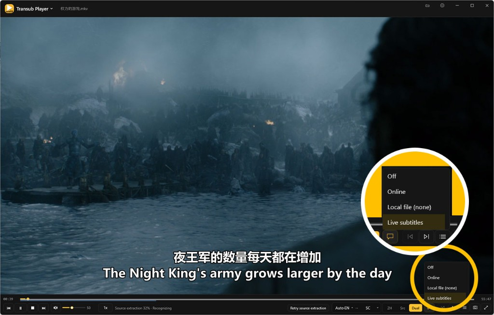

# Transub Player

<p>
  <a href="https://github.com/dlsandy/Transub-Player/releases"></a>
  <a href="https://github.com/dlsandy/Transub-Player/releases"></a>
  <a href="https://github.com/dlsandy/Transub-Player/stargazers"></a>
  <a href="https://github.com/dlsandy/Transub-Player/issues"></a>
  <a href="https://github.com/dlsandy/Transub-Player"></a>
  <a href="https://dotnet.microsoft.com/"></a>
</p>

<p>
  
  
  
  
  
  
</p>

[English](README.md) | [简体中文](README.zh-CN.md) | [日本語](README.ja.md) | [한국어](README.ko.md)

**Open a video. Subtitles follow.**

Foreign films, dramas, anime — watch first, even without a subtitle file.  
Open a video and the picture appears right away; readable subtitles catch up soon after. No more hunting subtitle sites just to keep watching.

<p align="center">
  
</p>

> Windows desktop player · v1.8.0  
> Download the installer or portable zip from [GitHub](https://github.com/dlsandy/Transub-Player/releases) or [GitCode](https://gitcode.com/AndyDai/Transub-Player/releases). You can also use **Check for updates** inside the app.

---

## Why Transub Player

**Live subtitles while you watch**  
Subtitles are generated on the fly with built-in speech recognition. Progress stays visible — you can tell it’s working, not hanging.

**Translation · Source · Dual — one click**  
Casual viewing? Switch to translation. Learning? Switch to dual. If translation isn’t ready yet, source subtitles still play — watching never stops.

**Chinese / Japanese / Korean / English / Spanish**  
Change source and target languages while playing; Spanish UI is available too. The file name can help guess the source language. Defaults aim for “understand quickly,” with room to upgrade later.  
More languages are planned.

**Streams play — and record**  
Open common network stream URLs directly. Want to rewatch later? Record to local storage in one step.

**Scan to play on your phone**  
Control-bar Wi‑Fi entry plus shared folders; pick files in the phone browser. Live subtitles still come from desktop Whisper / translation — switch translation / source / dual / off on the page. Minimize to tray so LAN and recognition keep running.

**Color grade & LUT**  
Right-click → Color grade: tweak brightness / contrast / saturation and more with live preview, or save named presets. Built-in 3D LUT looks, browse custom `.cube` / `.3dl`, or auto-apply a same-stem LUT next to the video.

**Picture enhance**  
Right-click → Picture enhance, or press `E` to cycle Off / Light / Enhance (sharpen, deband, high-quality scale). Default off; turn down if playback stutters.

**Seek thumbnail preview**  
Hover the progress bar to preview a frame at that time — easier scrubbing.

**Deep match with Transub**  
Generate high-quality subtitles with the Transub subtitle tool; when they’re ready, the player can prompt you to play them.

---

## Who it’s for

- You want to understand foreign media now — without hunting subtitle sites  
- You don’t have ready-made subtitles, and don’t want a heavy workflow just to watch one episode  
- You care more about “can I keep watching?” than “is this release-ready subtitle?”

For publish-ready Chinese subtitles, full cleanup, and QC, use the companion product [Transub](https://www.transub.cc).

---

## Download & start

1. Get a release from [GitHub Releases](https://github.com/dlsandy/Transub-Player/releases) or [GitCode Releases](https://gitcode.com/AndyDai/Transub-Player/releases) (or use **Check for updates** in the app):
   - **Installer** (recommended): `TransubPlayer-*-win-x64-setup.exe` — next, next, done
   - **Portable**: `TransubPlayer-*-win-x64.zip` — unzip and run `TransubPlayer.exe`
2. If SmartScreen says Windows protected your PC, choose **More info** → **Run anyway**
3. Finish the first-run setup wizard (you can associate common video formats)
4. Open or drop a video; if recognition / translation models aren’t installed yet, follow the prompts — then live subtitles start

> If a subtitle file already sits next to the video, it loads first; you can switch back to live subtitles anytime.  
> Installed builds store settings and models under `%LocalAppData%\Transub Player\data\`; portable builds use `data\` next to the exe.

### Three steps

1. Open or drop a local video (or open a stream URL)
2. Wait for subtitles, then watch along
3. Switch as needed: translation / source / dual (`1` / `2` / `3`)

---

## Shortcuts


| Action | Keys |
| --- | --- |
| Open | Ctrl+O |
| Play / Pause | Space · click video |
| Seek back / forward | ← / → |
| Translation / Source / Dual | 1 / 2 / 3 |
| Delay / advance subtitles | Z / X |
| Show / hide subtitles | V |
| Picture enhance (Off / Light / Enhance) | E |
| Playlist | L |
| Next / Previous | N / P |
| Fullscreen | F · F11 · Enter · double-click |
| Screenshot | S |
| Mute | M |
| Exit fullscreen | Esc |


More options live in the context menu and Settings (UI language, file associations, subtitle look, model install, and more).

---

## How it works


| Layer | Tech |
| --- | --- |
| Shell / UI | WPF |
| Video | mpv |
| Speech recognition | Built-in Whisper (whisper.cpp / GGML turbo, download on demand) |
| Translation | llama-server + Hy-MT GGUF (on demand) |


Main path: **open a local video → readable subtitles ASAP → translation can fall back → quit clean.**

---

## Build from source

Requires Windows + .NET SDK. First run needs network access to fetch mpv and models.

```powershell
powershell -ExecutionPolicy Bypass -File tools\fetch-mpv.ps1
dotnet run --project src\TransubPlayer\TransubPlayer.csproj
```

Pack a release (Player + mpv + embedded Whisper; model weights not included). Output goes to `artifacts\pack\` (setup + portable zip; [Inno Setup 6](https://jrsoftware.org/isinfo.php) is required to build the setup):

```powershell
powershell -ExecutionPolicy Bypass -File tools\pack-release.ps1
# Portable or setup only:
# powershell -ExecutionPolicy Bypass -File tools\pack-release.ps1 -Target Portable
# powershell -ExecutionPolicy Bypass -File tools\pack-release.ps1 -Target Setup
```

First recognition: Settings → Models → download whisper turbo.

---

## System requirements

- Windows 10 / 11 (64-bit)
- Internet required the first time to download recognition / translation models (offline playback afterward for prepared content)
- Optional GPU acceleration (auto or manual; with multiple GPUs, pick the recognition GPU under Settings → Advanced); works without a discrete GPU

---

## Tips

- Subtitles appear **slightly behind** the picture — normal for live generation; if they lag far behind, recognition can restart from the playhead (or use **Restart from here**)
- Goal is “understandable and followable,” not release-grade subtitles
- Without a translation model, source subtitles still work
- On quit, processes started by the player exit together — nothing left running in the background

---

## Changelog

See [CHANGELOG.md](CHANGELOG.md) (English) · [CHANGELOG.zh-CN.md](CHANGELOG.zh-CN.md) · [CHANGELOG.ja.md](CHANGELOG.ja.md) · [CHANGELOG.ko.md](CHANGELOG.ko.md)

---

## In one line

> Open it. Watch it. Subtitles catch up.
